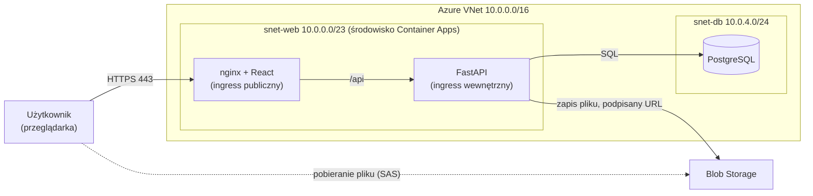

# Model Manager

Aplikacja webowa do zarządzania katalogiem zapisanych modeli uczenia maszynowego. Zalogowany użytkownik przegląda listę modeli i sprawdza ich szczegóły (framework, wersja, metryki, status), wyszukuje je, filtruje i sortuje, a administrator dodaje, edytuje i usuwa wpisy oraz wgrywa pliki modeli. Zalogowani użytkownicy pobierają te pliki na swój komputer. Każda zmiana modelu trafia do historii.

Projekt jest zbudowany w architekturze 3-warstwowej (React, FastAPI, PostgreSQL) i przygotowany do wdrożenia w Microsoft Azure.

## Dane dostępowe (do oceny)

| Element | Wartość |
|---|---|
| Adres aplikacji | _do uzupełnienia po wdrożeniu_ |
| Dokumentacja API (Swagger) | _adres aplikacji_`/api/docs` |
| Konto administratora | _login / hasło_ |
| Konto użytkownika | _login / hasło_ |

## Stan realizacji

| Funkcjonalność | Stan |
|---|---|
| Lista modeli, widok szczegółowy | ✅ |
| Dodawanie, edycja, usuwanie (CRUD) w interfejsie i API | ✅ |
| Walidacja po stronie klienta (React Hook Form + Zod) i serwera (Pydantic) | ✅ |
| Obsługa błędów, stany ładowania, komunikaty o sukcesie | ✅ |
| Baza PostgreSQL, migracje (Alembic), konfiguracja przez zmienne środowiskowe | ✅ |
| Testy automatyczne (back-end: pytest, front-end: vitest) i CI (GitHub Actions) | ✅ |
| Skanowanie sekretów i zależności w CI, ochrona gałęzi `main` | ✅ |
| Sieć w Azure: VNet, podsieci, NSG | ✅ skonfigurowane |
| Wdrożenie w Azure (Container Apps) i automatyczne CD z OIDC, healthcheck po wdrożeniu | ✅ po wykonaniu kroków z [docs/deployment.md](docs/deployment.md) |
| Rejestracja i logowanie (JWT), role `admin` i `user`, ochrona tras i endpointów | ✅ |
| Wyszukiwanie, filtrowanie, sortowanie i paginacja listy modeli | ✅ |
| Historia zmian modeli (kto, co i kiedy zmienił, w tym zmiany statusu) | ✅ |
| Upload i pobieranie plików modeli (Azure Blob Storage, podpisane adresy SAS) | ✅ sprawdzone lokalnie z emulatorem Azurite |

## Architektura



Linia przerywana to pobieranie pliku przez przeglądarkę bezpośrednio z magazynu, pod krótko ważnym adresem wydanym przez back-end. Opis warstw, przepływ danych i separację sieciową opisuje [docs/architecture.md](docs/architecture.md).

| Warstwa | Komponenty |
|---|---|
| Prezentacji | React, nginx (serwuje aplikację i przekazuje `/api` do back-endu) |
| Aplikacji | FastAPI: routers → services → repositories |
| Danych | PostgreSQL |

## Stack technologiczny

| Obszar | Technologia |
|---|---|
| Front-end | React 18, Vite, React Router, React Hook Form, Zod, Vitest |
| Back-end | Python 3.12, FastAPI, Pydantic, SQLAlchemy, Alembic, pytest |
| Uwierzytelnianie | JWT (PyJWT), hashowanie haseł Argon2id (pwdlib) |
| Baza danych | PostgreSQL |
| Pliki modeli | Azure Blob Storage (SDK `azure-storage-blob`), lokalnie emulator Azurite |
| Kontenery | Docker |
| CI/CD i bezpieczeństwo | GitHub Actions (logowanie do Azure przez OIDC), Gitleaks, pip-audit, npm audit, Dependabot |
| Chmura | Microsoft Azure |

## Struktura repozytorium

```
.
├── README.md        główny przewodnik po projekcie
├── .github/         workflow CI (GitHub Actions)
├── backend/         API (FastAPI): api, services, repositories, models, schemas, core
├── frontend/        aplikacja React (Vite), Dockerfile, szablon nginx
├── config/          pliki konfiguracyjne i wzory zmiennych środowiskowych
└── docs/            dokumentacja: API, architektura, diagramy, zrzuty ekranu
```

## Konfiguracja

Cała konfiguracja pochodzi ze zmiennych środowiskowych. W kodzie nie ma adresów, haseł ani kluczy. Pliki `.env` i `.env.local` są w `.gitignore`, a w repozytorium są tylko wzory `.env.example`.

**Back-end** (`backend/.env`, wzór: `backend/.env.example`)

| Zmienna | Opis |
|---|---|
| `DATABASE_URL` | Connection string do bazy PostgreSQL (wymagana, bez niej aplikacja się nie uruchomi) |
| `JWT_SECRET` | Sekret do podpisywania tokenów JWT (wymagany, minimum 32 znaki) |
| `JWT_EXPIRE_MINUTES` | Czas ważności tokenu w minutach, domyślnie 60 |
| `ADMIN_EMAIL`, `ADMIN_PASSWORD` | Dane pierwszego administratora, używane tylko przez `python -m scripts.create_admin` |
| `STORAGE_CONNECTION_STRING` | Magazyn plików lokalnie: `UseDevelopmentStorage=true` (emulator Azurite). W Azure zostaw puste |
| `STORAGE_ACCOUNT_URL` | Magazyn plików w Azure, np. `https://NAZWA.blob.core.windows.net`. Aplikacja używa wtedy tożsamości zarządzanej, bez kluczy |
| `STORAGE_CONTAINER` | Nazwa kontenera na pliki modeli, domyślnie `models` |
| `MAX_UPLOAD_MB` | Maksymalny rozmiar pliku modelu w MB, domyślnie 200 |
| `DOWNLOAD_URL_EXPIRE_SECONDS` | Czas ważności adresu pobierania, domyślnie 300 |
| `APP_VERSION` | Wersja aplikacji (skrót commita), wpisywana do obrazu podczas budowania. Zwraca ją `/api/health` |
| `APP_ENV` | Nazwa środowiska, domyślnie `development` |
| `CORS_ORIGINS` | Dozwolone źródła CORS, oddzielone przecinkami (puste, gdy ruch idzie przez nginx) |
| `POSTGRES_USER`, `POSTGRES_PASSWORD`, `POSTGRES_DB` | Tylko dla lokalnej bazy z `docker-compose.dev.yml` |

**Front-end** (`frontend/.env.local`, wzór: `frontend/.env.example`)

| Zmienna | Opis |
|---|---|
| `VITE_API_URL` | Adres API, domyślnie ścieżka względna `/api` |
| `DEV_PROXY_TARGET` | Tylko `npm run dev`: dokąd Vite przekazuje `/api` |
| `BACKEND_URL` | Tylko kontener nginx: adres back-endu, do którego trafia ruch `/api` |

## Uruchomienie lokalne

Wymagania: Python 3.12, Node.js 22.12 lub nowszy, Docker Desktop.

### 1. Baza danych

```bash
cd backend
cp .env.example .env        # uzupełnij POSTGRES_*, DATABASE_URL (to samo hasło w obu miejscach), JWT_SECRET, ADMIN_*
docker compose -f docker-compose.dev.yml up -d
```

To samo polecenie uruchamia także emulator Azure Blob Storage (Azurite, port 10000), w którym lokalnie zapisują się pliki modeli.

### 2. Back-end

```bash
python -m venv .venv
source .venv/bin/activate   # Windows (PowerShell): .\.venv\Scripts\Activate.ps1
pip install -r requirements-dev.txt
alembic upgrade head        # tworzy tabele
python -m scripts.create_admin  # tworzy konto administratora z ADMIN_EMAIL i ADMIN_PASSWORD
python -m scripts.seed      # opcjonalnie: 6 przykładowych modeli
uvicorn app.main:app --reload
```

API działa pod `http://localhost:8000`, a Swagger pod `http://localhost:8000/api/docs`. Sekret JWT wygenerujesz poleceniem `python -c "import secrets; print(secrets.token_urlsafe(48))"`.

Po uruchomieniu zaloguj się w aplikacji kontem administratora z `ADMIN_EMAIL` i `ADMIN_PASSWORD`, a konto zwykłego użytkownika utworzysz przez rejestrację.

### 3. Front-end

```bash
cd frontend
cp .env.example .env.local  # ustaw DEV_PROXY_TARGET=http://localhost:8000
npm install
npm run dev
```

Aplikacja jest dostępna pod adresem wypisanym przez Vite (zwykle `http://localhost:5173`).

### 4. Testy

```bash
cd backend && pytest        # testy API (logowanie, uprawnienia, lista, historia), osobna baza SQLite
cd frontend && npm test     # testy walidacji formularzy, parametrów listy i opisu historii
```

## API

Pełna dokumentacja (pola, reguły walidacji, przykłady, format błędów): [docs/api.md](docs/api.md). Interaktywna wersja: `/api/docs`.

| Metoda | Ścieżka | Opis | Dostęp | Kod |
|---|---|---|---|---|
| `GET` | `/api/health` | Stan API | publiczny | 200 |
| `POST` | `/api/auth/register` | Rejestracja (rola `user`) | publiczny | 201 |
| `POST` | `/api/auth/login` | Logowanie, zwraca token JWT | publiczny | 200 |
| `GET` | `/api/auth/me` | Dane zalogowanego użytkownika | zalogowany | 200 |
| `GET` | `/api/models` | Lista modeli: wyszukiwanie, filtry, sortowanie, paginacja | zalogowany | 200 |
| `GET` | `/api/models/{id}` | Szczegóły modelu | zalogowany | 200 |
| `GET` | `/api/models/{id}/history` | Historia zmian modelu | zalogowany | 200 |
| `GET` | `/api/models/{id}/download` | Krótko ważny adres do pobrania pliku modelu | zalogowany | 200 |
| `POST` | `/api/models/{id}/file` | Dodanie lub zastąpienie pliku modelu | administrator | 200 |
| `DELETE` | `/api/models/{id}/file` | Usunięcie pliku modelu | administrator | 200 |
| `POST` | `/api/models` | Utworzenie modelu | administrator | 201 |
| `PUT` | `/api/models/{id}` | Aktualizacja modelu | administrator | 200 |
| `DELETE` | `/api/models/{id}` | Usunięcie modelu | administrator | 204 |
| `GET` | `/api/history` | Dziennik zmian wszystkich modeli, także usuniętych | administrator | 200 |

Błędy: 400 (nieprawidłowe dane), 401 (brak lub nieprawidłowy token), 403 (brak uprawnień), 404 (nie znaleziono), 409 (konflikt, np. zajęty e-mail), 413 (plik za duży), 500 (błąd serwera), 502 (błąd magazynu plików), 503 (magazyn nie jest skonfigurowany).

## Role użytkowników

| Rola | Uprawnienia |
|---|---|
| `user` | Przeglądanie, wyszukiwanie i filtrowanie modeli podgląd historii zmian pojedynczego modelu oraz pobieranie plików modeli. Rola nadawana przy rejestracji |
| `admin` | Wszystko, co `user`, oraz dodawanie, edycja i usuwanie modeli wgrywanie i usuwanie plików oraz dziennik zmian wszystkich modeli |

Uprawnienia są egzekwowane po stronie serwera (kod 403), a interfejs dodatkowo ukrywa niedostępne akcje. Hasła są przechowywane wyłącznie jako hashe Argon2id. Konto administratora tworzy skrypt `scripts/create_admin.py` z danych w zmiennych środowiskowych, a rejestracja nigdy nie daje roli `admin`.

## Wdrożenie w chmurze

Sieć w Azure jest przygotowana: jedna sieć wirtualna (`10.0.0.0/16`) z trzema podsieciami i osobnymi grupami NSG.

| Podsieć | Zasób | Dostęp przychodzący |
|---|---|---|
| `snet-web` (`10.0.0.0/23`) | środowisko Container Apps: front-end (nginx + React, ingress publiczny) i back-end (FastAPI, ingress wewnętrzny) | front-end: Internet, porty 80 i 443; back-end: tylko z aplikacji środowiska, bez trasy z Internetu |
| `snet-app` (`10.0.2.0/23`) | zarezerwowana i niewykorzystywana (limit subskrypcji studenckiej: jedno środowisko Container Apps na region) | brak |
| `snet-db` (`10.0.4.0/24`) | PostgreSQL Flexible Server | tylko z `snet-web`, port 5432, bez adresu publicznego |

Aplikacja działa w jednym środowisku Azure Container Apps w `snet-web`: front-end (nginx + React) z publicznym adresem i back-end (FastAPI) z ingressem wewnętrznym, czyli bez trasy z Internetu. Baza PostgreSQL jest w osobnej, prywatnej podsieci `snet-db`. Obrazy trafiają do Azure Container Registry, a pliki modeli do Azure Blob Storage.

Pełna instrukcja (skrypty infrastruktury, konfiguracja GitHuba, reguły sieciowe, diagnostyka): [docs/deployment.md](docs/deployment.md).

- Publiczny adres aplikacji: _do uzupełnienia_
- Wersja wdrożona na produkcji: `<adres>/version.json` (front-end) i `<adres>/api/health` (back-end)

## Monitoring, logi i alerty

Konfiguracja monitoringu jest opisana kodem (`config/azure/05-monitoring.sh`, `06-budget-alerts.sh`).

### Endpointy stanu

| Endpoint | Co sprawdza | Odpowiedź |
|---|---|---|
| `GET /api/health` | czy proces działa i jaka wersja jest wdrożona (nie dotyka bazy) | `200`, `{"status":"ok","version":"<skrót commita>"}` |
| `GET /api/health/ready` | czy działa połączenie z bazą (zapytanie `SELECT 1`) i jak szybko odpowiada | `200`, `{"status":"ready","version":"...","checks":{"database":{"status":"ok","latency_ms":2.1}}}`, a gdy baza nie odpowiada `503` |
| `GET /healthz` (front-end) | czy działa nginx | `200 ok` |

Endpointy są publiczne i nie zwracają danych poufnych. Korzysta z nich healthcheck po wdrożeniu (CD) oraz skrypt `04-verify-security.sh`.

### Logi

| Źródło | Zawartość | Gdzie szukać |
|---|---|---|
| Logi kontenerów | linia JSON na żądanie: `request_id`, `method`, `route`, `status`, `duration_ms` | Log Analytics |
| Application Insights | żądania z czasem odpowiedzi, wyjątki, zapytania do bazy, logi aplikacji | Application Insights (Logs, Performance) |
| Logi serwera PostgreSQL | błędy i zapytania wolniejsze niż 1 s | Log Analytics (`AzureDiagnostics`) |
| Logi CI i CD | przebiegi pipeline'u | GitHub Actions |

Dziennik żądań nie zawiera tokenów, treści ani parametrów zapytania. Retencja to 30 dni, a dzienny limit danych (domyślnie 1 GB) chroni budżet.

### Dashboard

Dashboard w portalu Azure pokazuje: zużycie procesora i pamięci kontenera back-endu, liczbę żądań z podziałem na kody odpowiedzi, czas odpowiedzi API (mediana i 95. percentyl), zapytania do bazy oraz metryki serwera PostgreSQL. Widok na żywo: Application Insights, Live metrics. Instrukcja krok po kroku: `docs/deployment.md`, krok H.

### Alert budżetowy

Miesięczny budżet z powiadomieniami e-mail dla zespołu: progi 50%, 80% i 100% wydatków oraz 100% prognozy (`06-budget-alerts.sh` albo Cost Management, Budgets).


## Praca z repozytorium i CI

- Gałąź `main` jest chroniona: kod trafia do niej wyłącznie przez Pull Request, po zielonych wynikach wszystkich kontroli.
- Nowe funkcje powstają na gałęziach `feature/...`.
- Komunikaty commitów: `feat`, `fix`, `docs`, `chore`, `refactor`, `test`, `ci` (np. `feat(backend): add models CRUD endpoints`).
- Workflow [`.github/workflows/ci.yml`](.github/workflows/ci.yml) uruchamia: testy back-endu, testy i build front-endu, budowanie obrazu Docker front-endu, skanowanie sekretów (Gitleaks) oraz skanowanie zależności (`pip-audit`, `npm audit`).
- Dependabot co tydzień zgłasza aktualizacje zależności.
- Szczegóły, zasady reagowania na wyniki skanowania i ustawienia ochrony gałęzi: [docs/security.md](docs/security.md).
- Workflow [`.github/workflows/cd.yml`](.github/workflows/cd.yml) wdraża aplikację automatycznie po udanym CI na `main`: buduje i wysyła obrazy do rejestru, aktualizuje back-end, potem front-end, a na końcu sprawdza, czy publiczny adres zwraca właśnie wdrożoną wersję. Do Azure loguje się przez OIDC, bez haseł w sekretach.

## Autor

ERTUK03
